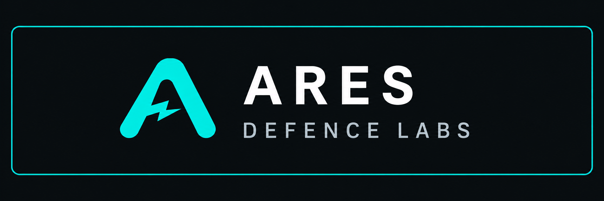

[](https://aresdefencelabs.com)

# AresPdfKit

**PDF document APIs. An editor that fits your app.**

Flutter PDF SDK from **Ares Defence Labs**: create and manipulate documents
through low-level APIs, or embed a configurable viewer/editor in your application.
One SDK, two integration modes, six Flutter targets.

[Quick start](docs/getting-started.md) · [PDF APIs](docs/low-level-api.md) ·
[Viewer & editor](docs/viewer-editor.md) · [API reference](docs/api-reference.md) ·
[Developer portal](https://aresdefencelabs.com/development-sdks?sdk=pdf-library&view=overview)

> **Commercial SDK — a paid licence is required for production use.**
> The SDK verifies signed licence keys offline. Missing, invalid or expired keys
> use a shared 60-second trial; supported reading remains available after the
> trial while advanced operations are locked.
>
> Developers supply the key in their application or private build configuration.
> Renewed keys must reach installed applications before the existing key expires.
> [Licensing, trial and renewal](docs/licensing.md)

## Choose your integration

**Preparation status:** local and unpublished. The documented compiled candidate
has bounded feature coverage; full parity and production acceptance remain open.
See [feature coverage](docs/feature-status.md) and [platform verification](docs/platforms.md).

| Integration | Entry point | Build your workflow |
| --- | --- | --- |
| **Low-level PDF API** | `AresPdfApi` | Your UI, with document creation, editing and export through typed operations. |
| **Viewer & editor** | `AresPdfViewer` | Embed the supplied workspace and configure tools, colors and host workflows. |

Both modes share compiled PDF processing and offline licence enforcement.
Use one direct `ares_pdf` dependency and the canonical import
`package:ares_pdf/ares_pdf.dart`. Desktop and Web runtime packages are coordinated
transitive dependencies.

[Explore the architecture](docs/architecture.md) ·
[Customize the editor](docs/customization.md) · [Connect host callbacks](docs/host-callbacks.md)

## See the PDF workspace

| Read & navigate | Draw & annotate | Review redactions |
| :---: | :---: | :---: |
|  |  |  |

**AresScan+ Android workflow references.** These show the reference app, including
features still being migrated to the protected SDK. The redaction preview shows
pending marks, not permanently removed content. The [visual guide](docs/visual-guide.md)
contains all seven supplied screenshots with feature-specific captions.

## Try the reference app

Explore the document workflows in **AresScan+**, the Ares Defence Labs mobile app.

[](https://play.google.com/store/apps/details?id=ai.aresdefencelabs.aresscan)
[](https://apps.apple.com/us/app/aresscan/id6759765449)

[Discover AresScan+](https://aresdefencelabs.com/ares-scan) ·
[Explore Ares Defence Labs SDKs](https://aresdefencelabs.com/development-sdks)

## Low-level API: create your first PDF

```dart
import 'package:ares_pdf/ares_pdf.dart';

Future<void> createPdf() async {
  final engine = await AresPdfApi.connect();
  try {
    final blank = await engine.createDocument();
    try {
      final edited = await blank.edit([
        const AresPdfText(page: 1, text: 'Hello PDF', x: 36, y: 72),
      ]);
      try {
        final bytes = await edited.exportBytes();
        // Save bytes with storage owned by your application.
      } finally {
        await edited.close();
      }
    } finally {
      await blank.close();
    }
  } finally {
    await engine.close();
  }
}
```

Connecting is normal SDK use and can start the real process/page trial. Do not
connect merely to preflight whether a customer might want a PDF feature later.

## Viewer mode: embed the editor

```dart
AresPdfViewer(
  bytes: pdfBytes,
  options: AresPdfViewerOptions(
    tools: const [
      AresPdfViewerTool.previous,
      AresPdfViewerTool.next,
      AresPdfViewerTool.zoomIn,
      AresPdfViewerTool.zoomOut,
      AresPdfViewerTool.undo,
      AresPdfViewerTool.redo,
      AresPdfViewerTool.exportPdf,
    ],
    onExport: savePdfBytes,
  ),
  onCreated: (controller) {
    // Retain this controller only while its widget/workspace is alive.
  },
  onError: (error) {
    // Present your app's error state.
  },
)
```

`pdfBytes` and `savePdfBytes` are application-owned values/functions. The full
[viewer guide](docs/viewer-editor.md) explains initialization, saving and cleanup.

## Developer guides

- [Installation and first PDF](docs/getting-started.md)
- [SDK architecture and integration modes](docs/architecture.md)
- [Low-level API and ownership](docs/low-level-api.md)
- [Viewer/editor integration](docs/viewer-editor.md)
- [Themes, tools and controller state](docs/customization.md)
- [All nine host callbacks and I/O limits](docs/host-callbacks.md)
- [Complete public API reference: 89 types](docs/api-reference.md)
- [Pages, graphics, layout, fonts and images](docs/document-authoring.md)
- [Forms and annotations](docs/forms-annotations.md)
- [Attachments, metadata, bookmarks and search](docs/document-management.md)
- [Office conversion](docs/office-conversion.md)
- [Spreadsheet scalar math](docs/spreadsheet-math.md)
- [Certificate signatures and timestamps](docs/signatures.md)
- [Offline CRL/OCSP document revocation](docs/document-revocation.md)
- [Encryption, protected readers and optimization](docs/security.md)
- [Offline SDK licensing, trial and renewal](docs/licensing.md)
- [Platform setup and exact verification scope](docs/platforms.md)
- [Web hosting, Wasm and asset requirements](docs/web.md)
- [Example application](docs/example.md)
- [Errors and troubleshooting](docs/troubleshooting.md)
- [Migration and AresScan+ integration](docs/migration.md)
- [Feature coverage and remaining work](docs/feature-status.md)
- [Release/distribution model](docs/releases.md)

## Platforms and licence

Android, iOS, macOS, Linux, Windows and Web have compiled members. Local candidate
checks executed Android emulator, iOS Simulator with SwiftPM/CocoaPods, macOS
programmatic checks, Linux debug/profile/release under containers/emulation and
Web in the in-app browser. **Windows runtime, macOS foreground UI, physical
devices and positive paid activation remain pending.** See [platforms](docs/platforms.md).

Production SDK use requires the commercial SDK terms and a
valid signed portal key. Missing, invalid or expired keys use the compiled trial
policy, including the exact popup:

> You are using a trial version of Ares Defence Labs PDF SDK

The trial is a genuine shared 60-second session. After expiry, advanced operations
are denied while supported reading remains available. Closing/reopening an
owner does not reset the trial. See [licensing](docs/licensing.md).

The repository's existing MIT licence covers its documentation/support material;
it does not grant rights to the separately distributed proprietary SDK binaries.
The commercial SDK terms are approved; third-party redistribution review and
remaining SDK acceptance are still publication gates.

[Developer portal](https://aresdefencelabs.com/development-sdks?sdk=pdf-library&view=overview)
· [Report an issue](https://github.com/Ares-Defence-Labs/AresPdfKit/issues)
· [Security reporting](SECURITY.md)

## About this repository

This public repository contains **documentation and support material only**.
It is not an installable Git dependency. SDK implementation, native binaries,
Web runtime and the runnable example belong in the reviewed package distribution.
The metadata-only `pubspec.yaml` here remains non-publishable.
