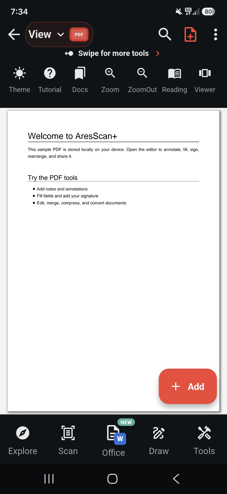
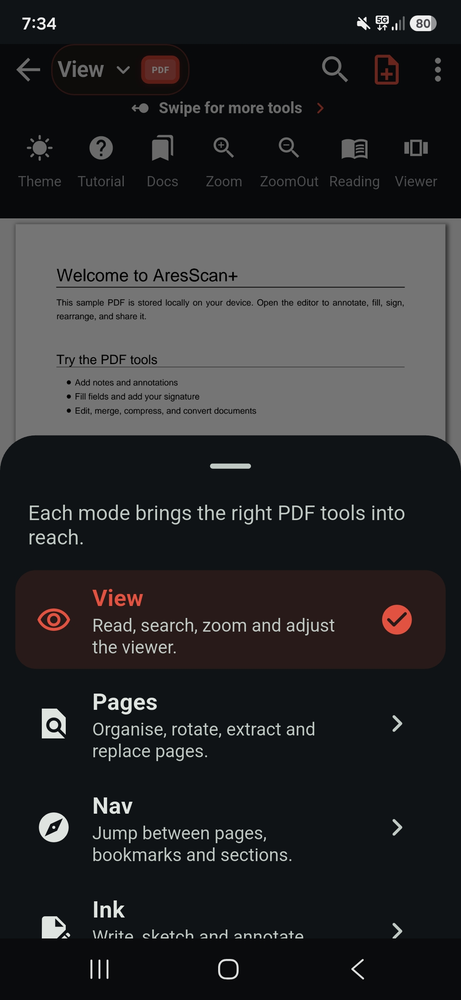
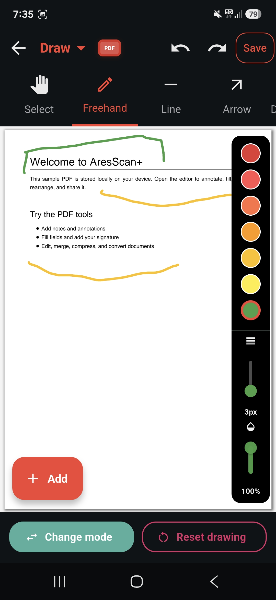
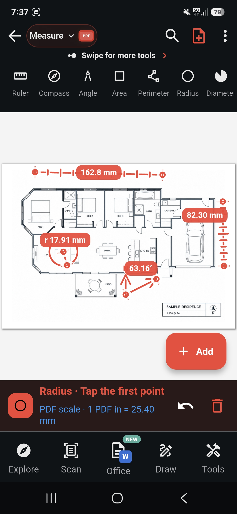
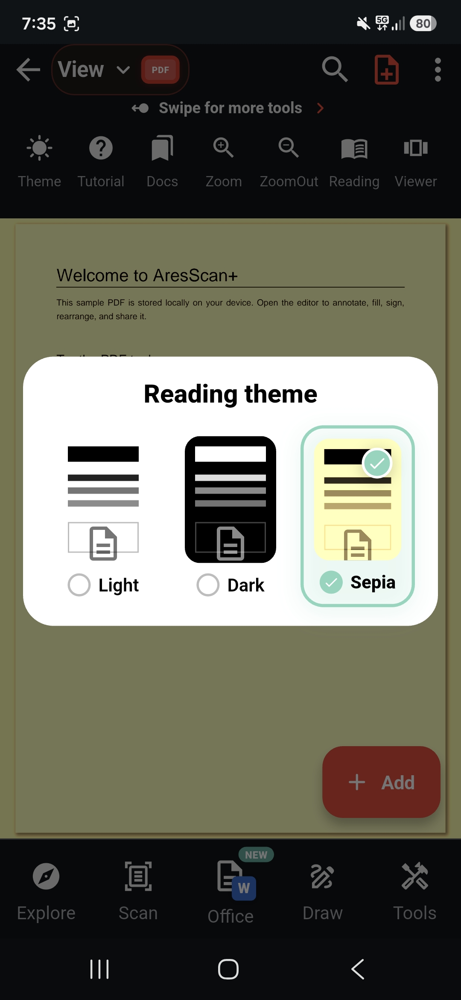
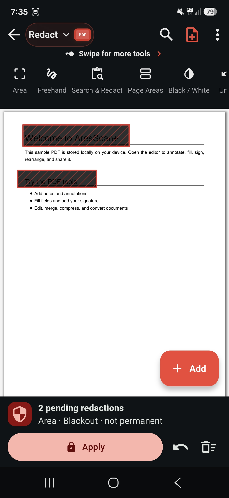

# PDF editor workflow gallery

These seven supplied screenshots show **AresScan+ on Android**, the Ares ecosystem
reference for the full PDF editor. They are unchanged captures, not mockups or
new acceptance evidence. App navigation and legacy editor controls shown here
are not all exposed by the current protected cross-platform SDK.

Use the [viewer integration guide](viewer-editor.md) and [feature status](feature-status.md)
for the actual public contract. The low-level API performs supported document
operations without displaying this interface.

## View a document

The sample document, View toolbar, zoom/reading controls and application
navigation illustrate the host experience. The SDK integration accepts document
bytes; your Flutter app owns navigation, storage and its surrounding layout.

## Choose an editor mode

The app groups workflows into modes such as View, Pages, Nav and Ink. The
protected SDK currently exposes 29 individual semantic tools, not a promise
that this complete legacy mode selector is available on every platform.

## Viewer overview

The second viewer capture retains the full host context. The bottom application
tabs and Add action are AresScan+ UI; they are not mandatory SDK chrome.

## Draw on a PDF

This illustrates the app's freehand workflow, pen color/width/opacity controls
and save/undo presentation. It does not establish that every freehand tool or
pixel configuration is already exposed by the canonical protected viewer.
Map application requirements explicitly during AresScan migration.

## Measure a plan

The app displays length, radius and angle overlays with a scale indicator.
Calibrated measurement is an Ares feature family still requiring complete
protected SDK APIs and platform acceptance. The screenshot alone does not prove
real-world dimensions, calibration accuracy or saved measurement semantics.

## Select a reading theme

The app offers reading treatments for the displayed page. These are distinct
from the current SDK's seven viewer UI color roles; changing toolbar background
does not automatically implement page recoloring. Exact Light/Dark/Sepia parity
in the protected viewer remains a separate implementation/acceptance requirement.

## Stage redactions

The screen explicitly shows **two pending redactions** and **not permanent**.
These are staged selections, not proof that underlying text/image data has been
removed. Permanent, content-preserving redaction remains an unfinished benchmark
family. Do not infer irreversible sanitization from a black overlay or this image.

## Platform interpretation

These Android captures define workflow context, not iOS/macOS/Windows/Linux/Web
verification. Both SDK modes target all six Flutter platforms. Exact runtime,
UI and functionality gates are listed in [platforms](platforms.md).
